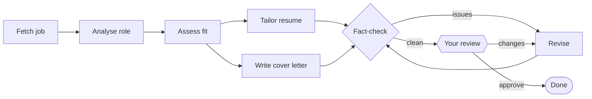

<div align="center">

# Job Application Agent

**Tailor your resume and cover letter to any job posting, without inventing anything.**

An AI agent built with [LangGraph](https://langchain-ai.github.io/langgraph/) and [Claude](https://www.anthropic.com/claude). It analyses the role, scores your fit, writes both documents, fact-checks them against your real experience, and waits for your approval.

[](https://github.com/RaedFidawi/Job-Application-Agent/actions/workflows/ci.yml)

[](https://langchain-ai.github.io/langgraph/)
[](LICENSE)

</div>

---

## Features

- **Fit analysis.** A 0–100 score with evidence from your resume for each strength, plus an honest list of gaps.
- **Tailored resume.** Your experience is reordered and reworded to match the role's priorities and keywords.
- **Cover letter.** Specific and concise, connecting your real achievements to what the job needs.
- **Fact-checking.** A second pass flags any skill, title, date or metric that isn't in your original resume, and the agent fixes it before you see the drafts.
- **You stay in control.** Approve the drafts, or describe what to change and get a revision, as many times as you like.
- **Resumable.** Progress is saved after every step, so an interrupted run picks up where it stopped.
- **Use it your way.** Web app or command line. Reads PDF, Markdown or plain-text resumes, and job postings by URL or pasted text.

## Installation

Requires **Python 3.11+** and an **[Anthropic API key](https://console.anthropic.com/settings/keys)**.

```bash
pip install git+https://github.com/RaedFidawi/Job-Application-Agent.git
```

Then make your API key available:

```bash
export ANTHROPIC_API_KEY="sk-ant-..."
```

> [!TIP]
> To keep the tool isolated from your other Python packages, install it with [pipx](https://pipx.pypa.io): `pipx install git+https://github.com/RaedFidawi/Job-Application-Agent.git`

## Usage

### Web app

```bash
job-agent-web
```

This opens the app in your browser. Paste a job URL or description, upload your resume, and click **Generate application**. Review the fit report and drafts, then either approve them or request changes. Download the final documents when you're done.

### Command line

```bash
job-agent --job https://company.com/careers/backend-engineer --resume ~/resume.pdf
```

The agent shows your fit report and writes the drafts to `./application/resume.md` and `./application/cover_letter.md`. Read them in your editor, then press **Enter** to approve or type what you'd like changed.

| Option | Description |
|---|---|
| `--job URL` | Job posting URL |
| `--job-file PATH` | Text file with the job description, for sites that block scraping such as LinkedIn |
| `--resume PATH` | Your resume (`.pdf`, `.md` or `.txt`) |
| `--out DIR` | Where to write the documents (default: `./application`) |
| `--model NAME` | Claude model (default: `claude-opus-5-5`) |
| `--effort LEVEL` | `low`, `medium` (default) or `high` |
| `--thread ID` | Resume a paused or interrupted run |

### Configuration

| Environment variable | Default | Description |
|---|---|---|
| `ANTHROPIC_API_KEY` | | **Required.** In the web app you can enter it in the sidebar instead. |
| `JOB_AGENT_MODEL` | `claude-opus-5-5` | `claude-sonnet-5-5` or `claude-haiku-5-5` cost less. |
| `JOB_AGENT_EFFORT` | `medium` | How much the model reasons before answering. |

A typical run makes about six model calls, and more if revisions are needed.

## How it works



The agent is a LangGraph state machine. The two drafts are written in parallel, a bounded fact-check loop catches fabricated claims, and `interrupt()` pauses the graph for your review. Progress is checkpointed after every step, which is what makes pausing and resuming possible.

See **[docs/ARCHITECTURE.md](docs/ARCHITECTURE.md)** for a walkthrough of the graph and the LangGraph features it uses.

## Privacy

Your resume and the job posting are sent to Anthropic's API to generate the documents. Nothing else leaves your machine. The command-line tool saves run state to `~/.job_agent/checkpoints.sqlite`. The web app keeps it in memory and never stores your API key.

## Development

```bash
git clone https://github.com/RaedFidawi/Job-Application-Agent.git
cd Job-Application-Agent
python -m venv .venv && source .venv/bin/activate
pip install -e ".[dev]"
cp .env.example .env   # add your API key

pytest                 # tests use a fake LLM: free and offline
ruff check .
langgraph dev          # step through the graph visually in LangGraph Studio
```

To host your own copy of the web app, see **[docs/DEPLOYMENT.md](docs/DEPLOYMENT.md)**.

## Roadmap

- [ ] Export to DOCX and PDF
- [ ] Research the company with a web-search tool before writing
- [ ] Track applications across runs with long-term memory
- [ ] Persistent web sessions with a Postgres checkpointer
- [ ] An evaluation set of real postings to measure fact-check accuracy

## License

[MIT](LICENSE) © Raed Fidawi
