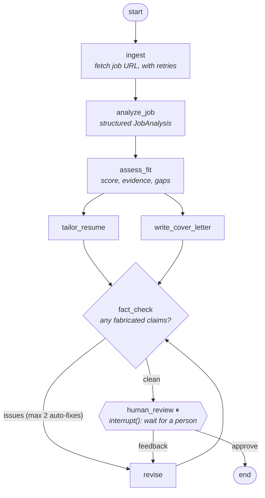

# Architecture

Job Application Agent is a [LangGraph](https://langchain-ai.github.io/langgraph/) state machine. Each step is a node, edges decide what runs next, and a checkpointer saves the state after every step.

## The graph



| Node | What it does |
|---|---|
| `ingest` | Downloads the job posting and strips it to plain text. Retries on network and 5xx errors. Blocked or JavaScript-only pages raise a clear "paste the text instead" error. |
| `analyze_job` | Extracts the title, seniority, must-haves, nice-to-haves and ATS keywords as a validated `JobAnalysis`. |
| `assess_fit` | Scores the candidate 0–100, citing evidence from the resume for each strength and listing gaps. |
| `tailor_resume`, `write_cover_letter` | Run in parallel. Both are told never to invent experience. |
| `fact_check` | A second Claude pass that compares both drafts to the original resume and lists every unsupported claim. |
| `revise` | Rewrites both drafts to address the fact-check issues or the human's feedback. |
| `human_review` | Pauses the graph with `interrupt()` until a person approves or asks for changes. |

## LangGraph concepts used

| Concept | How it's used | Where |
|---|---|---|
| **State** | One typed dict shared by all nodes. Each node returns only the keys it changed. | `state.py` → `AgentState` |
| **Fan-out / fan-in** | Two edges out of `assess_fit` run both drafting nodes in the same step. `add_edge([a, b], c)` waits for both to finish. | `graph.py` |
| **Conditional edges and cycles** | `route_after_fact_check` chooses between `revise` and `human_review`, creating a loop that is capped by `max_auto_revisions`. | `nodes.py` |
| **Human-in-the-loop** | `interrupt(payload)` saves the state and stops. The client resumes with `Command(resume=decision)`. | `nodes.human_review`, `runner.py` |
| **Command routing** | `human_review` returns `Command(goto=..., update=...)`, choosing its next node and updating the state in one step. | `nodes.human_review` |
| **Checkpointing** | SQLite in the CLI, so runs survive crashes and can be resumed with `--thread`. In-memory in the web app. | `cli.py`, `web.py` |
| **Runtime context** | The API key and model are passed per run through `context=AgentContext(...)` and are never written to checkpoints. | `state.py` → `AgentContext` |
| **Retry policy** | `RetryPolicy` on `ingest` retries only transient network errors. | `graph.py` |
| **Structured output** | Pydantic schemas with Claude's native JSON-schema mode. | `llm.py`, `state.py` |

## Clients

The graph doesn't know about any UI. Every client uses the same three calls (see `runner.py`):

```python
graph.stream(inputs, config, context=ctx)                   # run until done or paused
graph.get_state(config).interrupts                          # what is it waiting for?
graph.stream(Command(resume=decision), config, context=ctx) # continue
```

- `cli.py`: terminal client with a SQLite checkpointer
- `web.py`: Streamlit client with an in-memory checkpointer
- `langgraph dev` / LangGraph Studio: loads `graph.py:graph` through `langgraph.json`

## Project layout

```
src/job_agent/
├── graph.py     # graph wiring: start here
├── nodes.py     # one function per step
├── state.py     # state, structured-output schemas, runtime context
├── prompts.py   # prompts for each LLM step
├── llm.py       # model construction
├── tools.py     # job-page fetching and resume parsing
├── runner.py    # start / resume helpers shared by the clients
├── cli.py       # `job-agent` and `job-agent-web` entry points
└── web.py       # Streamlit UI
tests/           # fake-LLM tests for the control flow, tools and UI
```

## Testing

The tests swap Claude for a scripted fake by patching `llm.get_model`, so they're free, deterministic and need no API key. They check behaviour rather than wording: both drafts finish before the fact-check, the revision loop stops at its cap, interrupt and resume work, and human feedback reaches the revise step.
